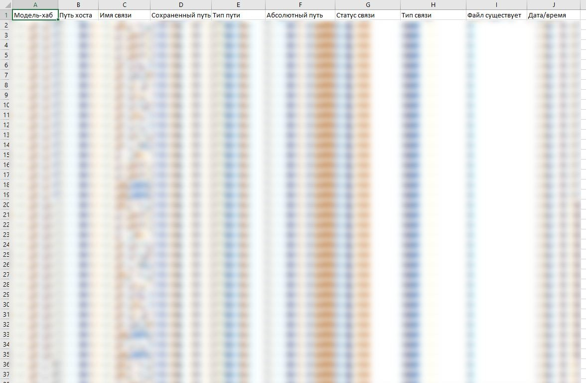
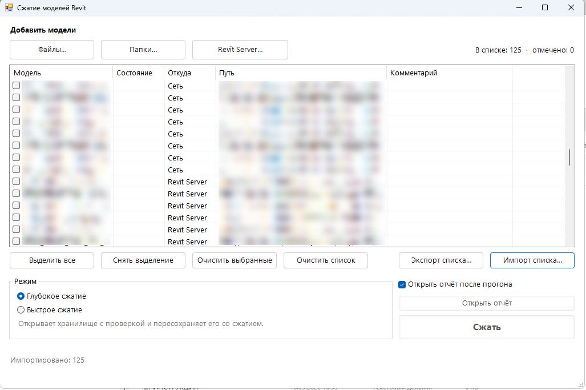
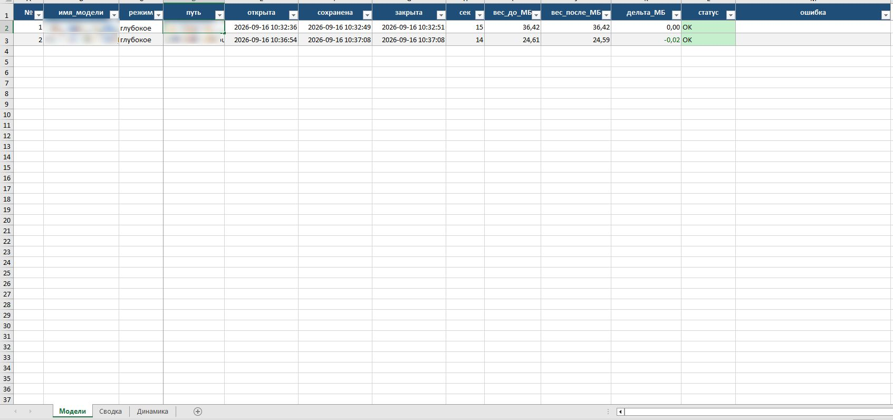
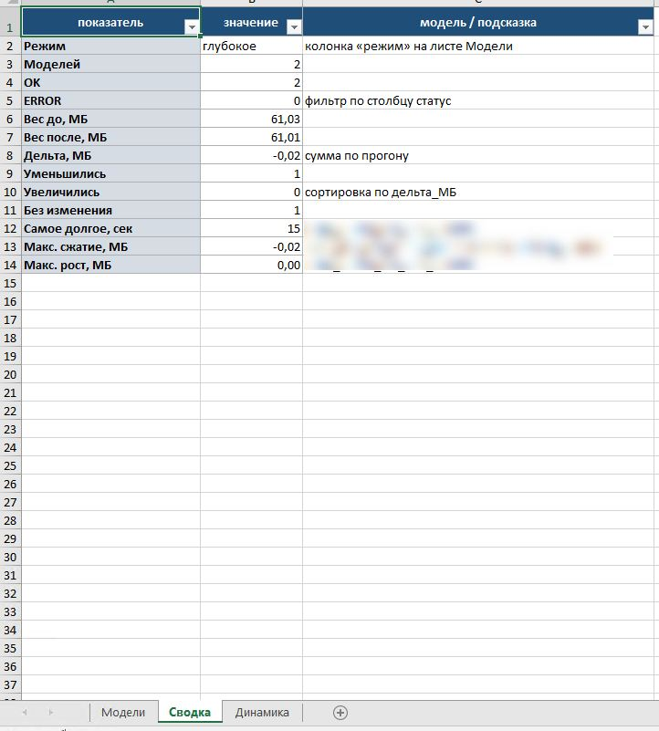

# BIM Revit Automation Portfolio

**Revit Automation & BIM Manager (MEP) | Revit API, Dynamo, Navisworks**

[](LICENSE)
[](cases/)
[](cases/)

Operator-facing automation for Autodesk Revit: **compact workshared models**, rename / year-upgrade / relink across many models, weekly health audits, units / levels alignment, alerts on exchange folders.

I write the **task scripts + Windows toolkits** (pick models → run → Excel report). [Revit Batch Processor](https://github.com/bvn-architecture/RevitBatchProcessor) (RBP) is one open-source batch host I use for Revit API jobs — not my product, and not every case needs it (see [Third-party](#third-party)).



*Case 02 health-check Excel report: summary metrics and RVT link inventory.*

| | |
|---|---|
| **Author** | [assssdrew](https://github.com/assssdrew) |
| **Stack** | Revit API · IronPython · Dynamo (CPython3) · PowerShell · WinForms · OpenXML · Excel formulas · FTP / ntfy |
| **Focus** | Workshared / Revit Server (`RSN://`) pipelines, safety-first writes |
| **Language** | [Русский README](README.ru.md) |

> Tested on real working models. Batch workflows are on average about 4–5× faster than the same work done by hand. Examples are anonymised.

---

## Quick start (3 steps)

For the Revit API cases (01, 02, 03, 05, 06). Case 04 is a standalone PowerShell watcher. Case 07 is a Dynamo Player graph: one shared script folder, and each run writes `Квартирография` next to the HVAC model (next to the central file when the model is workshared) — see its README.

1. **Prepare a PC** with Windows, PowerShell, the Revit year that matches your models, and [Revit Batch Processor](https://github.com/bvn-architecture/RevitBatchProcessor). Copy the case `src/` folder next to it and edit `servers.cfg` (placeholder Revit Server hosts in this repo).
2. **Build the model list** with the case's picker (`choose_models_path.cmd`; case 05 is `Сжатие.vbs` (Compact launcher), case 06's new window is `Операции с моделями.vbs` (Model operations launcher)).
3. **Run the task** in RBP (e.g. `health_check.py`) on a **disposable local copy first**, then read the report (CSV and Excel report). Details and the exact RBP settings are in each case README.

---

## File names and UI language

Some script names, operator notes, and on-screen labels are Russian. English equivalents:

| In the repo | English |
|---|---|
| [`ИНСТРУКЦИЯ.txt`](cases/05-compact-save/src/ИНСТРУКЦИЯ.txt) | Operator instructions (case 05) |
| [`Сжатие.vbs`](cases/05-compact-save/src/Сжатие.vbs) | Compact launcher. Window «Сжатие моделей Revit»; «Сжать» = Compact; «Быстрое сжатие» / «Глубокое сжатие» = Fast compact / Deep compact |
| [`Операции с моделями.vbs`](<cases/06-model-ops/src/Операции с моделями.vbs>) | Model operations launcher (case 06). `show_ops.vbs` opens the same window. Window title «Операции с моделями Revit» |
| [`Выгрузка_квартирографии.dyn`](cases/07-apartment-schedule-export/src/Выгрузка_квартирографии.dyn), [`Выгрузка_квартирографии.py`](cases/07-apartment-schedule-export/src/Выгрузка_квартирографии.py), [`Квартирография_ШАБЛОН.xlsx`](cases/07-apartment-schedule-export/src/Квартирография_ШАБЛОН.xlsx), [`Инструкция_Выгрузка_квартирографии.docx`](cases/07-apartment-schedule-export/src/Инструкция_Выгрузка_квартирографии.docx) | Apartment schedule export (case 07): Dynamo graph «Выгрузка квартирографии», node source, Excel template, Word instructions. A run writes `Квартирография_<code>.xlsx` in a `Квартирография` folder next to the HVAC model. Sheet «Типовые этажи» = Typical floors; the only Player input, «Связь АР» = Architectural link |

These files keep their names: the launchers and task scripts refer to them by name.

---

## Cases

One table for status and scale. Batch sizes are anonymised figures from a multi-discipline project. Case 07 is the verified result on one building. The health-check Excel report is the screenshot at the top of this page.

| # | Case | Status | Scale |
|---|------|--------|-------|
| 01 | [Project Units + RSN](cases/01-project-units/) | Tested on real working models | Length accuracy in one batch across disk, UNC, and live `RSN://` |
| 02 | [Health Check](cases/02-health-check/) (v1.4.0) | Tested on real working models; read-only (no model changes) | Health metrics and RVT links in one Excel report and a CSV batch |
| 03 | [Levels & Grids](cases/03-levels-grids/) | Tested on real working models; MVP scope (Apply on base files only) | Weekly cascade: ~5–6 base files (BF↔AR), then up to ~80 discipline models (vs BF); one audit report session per wave |
| 04 | [FTP model alerts](cases/04-ftp-model-alerts/) | Tested on real working models | Phone push when shared FTP folders change, without watching the client |
| 05 | [Compact save](cases/05-compact-save/) | Tested on real working models; RSN deep mode on a limited number of runs | Long lists (e.g. ~125 models) in one unattended run; file-size change varies (up to about −11.6% on one early fast-mode model) |
| 06 | [Model operations](cases/06-model-ops/) (v3.0.0) | Tested on real working models | ~50+ models, mixed UNC / `RSN://`; one saved job plan for staged Save As, move, and relink |
| 07 | [Apartment schedule export](cases/07-apartment-schedule-export/) | Tested in Excel on one real building | One shared script folder; rooms read from the architectural link; the report is written next to the HVAC model (next to the central file when the model is workshared). 166 apartments, floors 2–17, collapsed into 10 groups (2 \| 3 \| 4 \| 5 \| 6 \| 7–12 \| 13–14 \| 15 \| 16 \| 17) |

#### Case 05 — Compact save (screenshots)

Operator window (deep mode, mixed network and Revit Server list):



Excel report — sheet «Модели» (Models), deep mode, two models, both OK:



Excel report — sheet «Сводка» (Summary), layout of the run totals (this picture is a two-model sample):



#### Case 07 — Apartment schedule export (sample data)

Sheet «Типовые этажи» (Typical floors) with made-up apartments, so the picture is not a project export. Floors that share a room signature share a colour. Empty apartment columns are omitted. The verified building result (166 apartments, 10 groups) is in the table above and in the [case README](cases/07-apartment-schedule-export/).


New cases are added as folders under `cases/` — see [docs/HOW_TO_ADD_CASE.md](docs/HOW_TO_ADD_CASE.md).
Also in `docs/`: a [draft Navisworks clash-tolerance matrix](docs/navisworks-clash-tolerances.md) (a discussion document, not code and not a company standard).

---

## Featured

**Compact save** ([case 05](cases/05-compact-save/)) — operator UI (`Сжатие.vbs`, Compact launcher): **fast** (Create New Local, Sync Compact) and **deep** (central + Audit, Save As same central with Compact). Long lists (e.g. ~125 models) run unattended. See the [case 05 screenshots](#case-05--compact-save-screenshots) above.

**Model operations** ([case 06](cases/06-model-ops/)) — rename, folder / Revit year, and RVT relink in staged passes via `Операции с моделями.vbs` (Model operations launcher) → `presets.ps1` (with `start_ops.ps1` and `job_lib.ps1`).

---

## Problem → approach

**Weekly reality on a multi-discipline project:** architecture updates land on the server; base files (BF) and many discipline models must stay aligned on units, model health, levels and grids. Centrals also need periodic Compact. A park move (names / year / links) has to be staged so hosts are not saved before their links exist.

Manual open-check-fix does not scale. These toolkits:

1. Build a model list (folder / files / Revit Server)
2. Run the Revit API job (batch host or a dedicated window)
3. Emit Excel reports with status highlighting (**GREEN / YELLOW / RED**) — or size before/after for Compact
4. Apply writes only where the risk is understood (units; BF levels/grids; Compact with an explicit mode; model-ops after Save job) — never blind coordinate fixes

---

## Safety rules

Automation that can destroy a federated model is worse than no automation.

- **Audit** scripts never Save / Sync / Relinquish
- **Apply** is a separate script / explicit list (e.g. BF only)
- **Compact** is a write: fast uses Create New Local; deep opens the central with Audit and saves the same central with Compact (no Detach). RSN deep mode needs RBP patch v4 (`RSN_PATCH_PS_v4`); tested on a limited number of runs.
- **Model operations** writes only after Save job; Detach is the local upgrade buffer, not the live central
- Coordinates, PBP, Survey Point, True North, Shared Coordinates are **out of scope** here — report only (Health Check), never auto-fix
- Tolerances are mandatory to avoid false RED on floating-point noise

Details: [docs/SAFETY.md](docs/SAFETY.md)

---

## Stack and scope

- **Revit API** task scripts (IronPython) run through [Revit Batch Processor](https://github.com/bvn-architecture/RevitBatchProcessor); operator tooling in **PowerShell** and **WinForms**; **OpenXML** Excel reports (no Excel COM on UNC).
- **Focus:** workshared and Revit Server (`RSN://`) models — read-only audits, controlled batch writes (units, levels/grids on base files, Compact, staged model operations).
- **Platform:** Windows. Case 04 adds FTP polling and phone push (ntfy / Telegram). Case 07 is Dynamo (CPython3) plus an Excel workbook of formulas. The graph and template stay in one shared folder; each run writes the report beside the HVAC model (beside the central file when the model is workshared). It does not use Revit Batch Processor and does not write the model.
- **Docs:** sample reports under `samples/`, screenshots under `docs/img/`, safety notes in [docs/SAFETY.md](docs/SAFETY.md).

---

## Third-party

- **[Revit Batch Processor](https://github.com/bvn-architecture/RevitBatchProcessor)** (Dan Rumery, BVN) is the batch host for the RBP-based cases. It is **not** included in this repository; install it separately. RBP is licensed under **GPL-3.0**.
- `cases/06-model-ops/src/rbp_open_fail_patch/` contains **two modified copies of RBP scripts** (`revit_dialog_util.py`, `revit_failure_handling.py`) with the original “Copyright (c) 2020 Dan Rumery, BVN” notice. They are **derivative works of RBP and are covered by GPL-3.0**, not by this repository's MIT licence.
- `cases/01-project-units/src/rbp_rsn_patch/` (and its copy in case 05) is a PowerShell script that edits **your installed** RBP `Scripts` folder to accept `RSN://` paths (it creates `*.bak_before_rsn` backups); it does not ship RBP code.

See [NOTICE](NOTICE) for details.

---

## Repository layout

```text
bim-revit-automation/
  README.md / README.ru.md     ← portfolio hub
  NOTICE                       ← third-party notices (RBP, GPL-3.0 patch files)
  cases/
    01-project-units/src/
    02-health-check/src/
    03-levels-grids/src/
    04-ftp-model-alerts/src/   ← FTP poller + phone alerts (no Revit API)
    05-compact-save/src/       ← operator UI + Compact task
    06-model-ops/src/          ← presets UI + Save As / relink pipeline
    07-apartment-schedule-export/src/  ← shared Dynamo graph; reports next to the HVAC model (no RBP)
  samples/                     ← anonymised report snippets
  docs/
    img/                       ← compact, health-check, and typical-floors screenshots
```

Copy a case `src/` onto a PC with the matching Revit year. Case 04 runs standalone on Windows (Task Scheduler). Case 05 starts from `Сжатие.vbs`. Case 06 starts from `Операции с моделями.vbs`; `run_cascade.cmd` is the older menu.

---

## Requirements

- Autodesk Revit (year matching the models; units toolkit targets 2022+)
- Windows + PowerShell
- [Revit Batch Processor](https://github.com/bvn-architecture/RevitBatchProcessor) for the Revit API batch cases (01–03, 05–06)
- Case 07: Revit 2024, Dynamo (CPython3), Microsoft Excel 2010 or newer (`Data.ExportExcel`). The HVAC model must be a saved disk or UNC file (a cloud or Revit Server model has no folder beside it). No Revit Batch Processor.

---

## Disclaimer

Scripts are provided as portfolio / starting points. Validate on a disposable local before any production write. Project paths, names and server hosts are sanitised or replaced with placeholders in this public repo.
