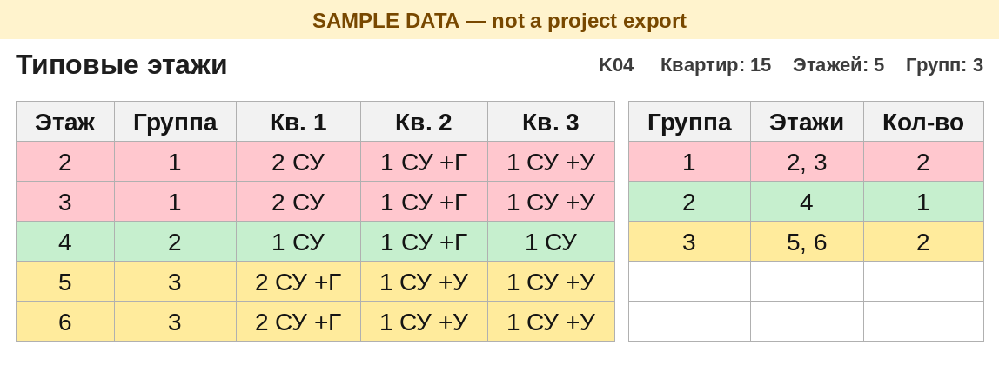

# Case 07 — Apartment schedule export (v7)

[← Portfolio hub](../../README.md) · [RU](README.ru.md)

## Problem

On a residential project with several buildings, the HVAC engineer needs identical floors: floors whose apartments carry the same set of rooms — combined bathroom (СУ), WC (уборная), walk-in closet (гардеробная). The deliverable is his «Таблица 1»: Floor | No. | Type | Rooms | Total area | Living area | Bathroom | WC | Closet. He also needs common-area areas by floor (stair, airlock, airlock in a fire-safe zone, corridor, lift lobby), with a floor total and a building total.

Revit only supplies the raw room rows. Every total, group number, and both tables are calculated in Excel, so a colleague can see the formula and change it. The same task comes back on the next project, with a different architectural team and different parameter names, so those names have to be a setting, not a hardcoded lookup.

The graph is «Выгрузка квартирографии» (Apartment Schedule Export), version 7. One run is one building.

## Solution

A Dynamo graph (Revit 2024, CPython3) reads rooms from the **loaded architectural link** and writes two raw sheets in `Квартирография_Kxx.xlsx`. One apartment row is one room. Nothing is aggregated in Revit.

- Python’s standard library (`zipfile` and XML) writes the workbook. `Data.ExportExcel` is not used, and Excel is not started. Before each write, «Выгрузка» and «Выгрузка МОП» are cleared, so old rows do not remain. The workbook is marked `fullCalcOnLoad`, so Excel recalculates when the file opens.
- One copy of the graph and the template serves every project. They live in a shared office folder. In this repository that path is the placeholder `\\server\share\Dynamo\Выгрузка квартирографии`. `SCRIPT_DIR` in the Python node points there, and `Квартирография_ШАБЛОН.xlsx` is read from that folder.
- Reports are written beside the open HVAC model, in a `Квартирография` folder. For a workshared model the folder is created next to the **central file**. The file name is `Квартирография_Kxx.xlsx`, where `Kxx` is the building code from the link name. A model that is still unsaved, a cloud model (BIM 360 / ACC), or a Revit Server model (`RSN://`) has no such folder, and the graph stops with text in the Player output.
- One run exports one architectural link. If exactly one architectural link is loaded, it is chosen automatically. The only Player input, «Связь АР», is an optional name fragment for when several links are loaded. Matching ignores case, `_` / space / `-` / `.`, and Cyrillic/Latin look-alike letters.
- Areas are rounded to hundredths (`AREA_DECIMALS = 2`).
- Common areas go to «Выгрузка МОП» and are summarised on «МОП»: one column per name, a floor total, and a building total. The names are `MOP_NAMES` in the script and column F on «Настройки» (up to 10). The defaults are stair, airlock, airlock (fire-safe zone), corridor, and lift lobby.
- «Таблица 1» separates floors with conditional formatting: a line at each new floor, and a grey fill on every other floor.
- «Типовые этажи» gives each group its own colour from a 40-colour palette, and a summary sorted by group (group, floor list, count).
- The Player output «Результат» is the whole status. A success starts with `ГОТОВО:`. An error starts with `ОШИБКА:`, including a “file is busy” message when the workbook is open. There is no `…_ОШИБКА.xlsx`.
- The first v7 run against a v6 workbook (no «МОП» sheet) renames it to `Квартирография_<code>_старый_<date>.xlsx` and copies a new file from the template.
- The template is formulas only (Excel 2010+, no macros): «Настройки», hidden calculation sheets, «Типовые этажи», «Таблица 1», «МОП». References into «Выгрузка» go through `INDIRECT`, so replacing that sheet does not turn them into `#REF!`.

`KLWT_*` strings in the Python node are **example parameter names** from one client’s shared parameters. Change the НАСТРОЙКИ block for the next architectural model. Room-name variants are edited on «Настройки» without touching formulas.

Limits of the template: 15 apartments per floor, 80 floors, 1500 apartments, 3000 export rows, 10 common-area names, 40 group colours before the palette repeats.

## Screenshot

«Типовые этажи» after a LibreOffice recalc of **sample rows** (not a project export). Unused apartment columns are omitted so the three made-up apartments and the group list sit together. Group colour is what the sheet is for. The verified project result is in the table below, not in this picture. The picture is from the earlier palette; v7 assigns one colour per group from a 40-colour list and adds the group summary.

## Project scale / context

| Item | Result |
|------|--------|
| Status | Tested in Excel on one real building |
| Impact | 166 apartments, 16 floors (2–17), collapsed into 10 groups: 2 \| 3 \| 4 \| 5 \| 6 \| 7–12 \| 13–14 \| 15 \| 16 \| 17 |
| Writes model? | **No** — reads the architectural link; writes an `.xlsx` beside the HVAC model (beside the central file when the model is workshared) |
| Repeats? | Every project, one building per run, from one shared script folder; parameter names, room names, and common-area names are settings |

## Safety

- The graph does not save, sync, or relinquish the open HVAC model. It reads rooms from the link document.
- It creates `Квартирография` and the building workbook next to that model. On a workshared model that write sits next to the central file, so the account needs permission there.
- Audit/apply rules for batch model writes do not apply here; there is no model write. See [docs/SAFETY.md](../../docs/SAFETY.md) for the rest of the portfolio.
- The published graph ships with the placeholder `SCRIPT_DIR` above. Point it at the shared script folder you actually use before a real run.
- A failure is text in «Результат». It is not written into a building report, and there is no separate error workbook.

## Lessons

- The Dynamo **editor** does not re-run a Python node whose code did not change. Run from **Dynamo Player** (or change an input) so the export actually executes. Read «Результат» after the run.
- Writing the sheets with `zipfile` leaves no Excel process behind. If the building file is open, the run stops with “file is busy” and does not write.
- `fullCalcOnLoad` recalculates on open. Template formulas still use `INDIRECT` into «Выгрузка».
- A v6 workbook is renamed to `*_старый_<date>.xlsx` once, on the first v7 run, because it has no «МОП» sheet.
- Choosing a link by a short name fragment mixed up buildings (`…_01_…` vs `…_02_…`) when letters looked alike. The graph auto-picks the single loaded architectural link, and a typed fragment is matched without case, separators, or Cyrillic/Latin look-alikes.
- A workshared local copy is the wrong neighbour for the report: the folder is created next to the central. Cloud and Revit Server models stop with an explicit error.

## How to run

1. Put `Выгрузка_квартирографии.dyn` and `Квартирография_ШАБЛОН.xlsx` in the shared script folder. Set `SCRIPT_DIR` in the Python node to that folder (the repository copy uses `\\server\share\Dynamo\Выгрузка квартирографии`).
2. Once per PC: Dynamo Player → set that folder. Leave «Связь АР» empty when the model has one architectural link.
3. Open the HVAC model of one building (architectural link loaded, model saved on disk or a file share) → Player → Run.
4. Read «Результат», then open `Квартирография` next to the model, or next to the central file, and `Квартирография_Kxx.xlsx`.

Step-by-step, including the settings block: [src/INSTRUCTION.md](src/INSTRUCTION.md) · [src/INSTRUCTION.ru.md](src/INSTRUCTION.ru.md).

Rebuild the template (header only, no project rows): `python build.py empty Квартирография_ШАБЛОН.xlsx` from `src/`. Rebuild the Word instruction after editing `mk.py`: `python mk.py`.

Code and graph: [`src/`](src/)
