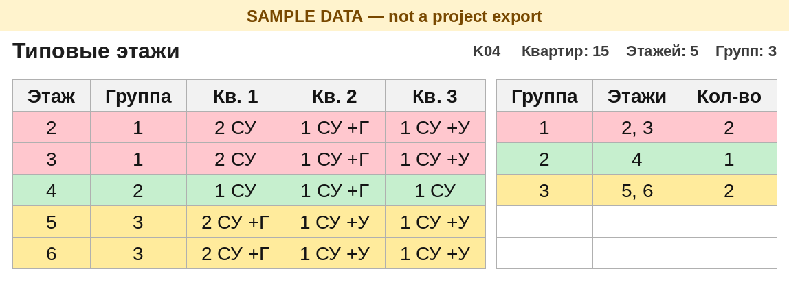

# Кейс 07 — Выгрузка квартирографии (v7)

[← К хабу](../../README.ru.md) · [EN](README.md)

## Проблема

На жилом объекте из нескольких корпусов инженеру ОВ нужен список типовых этажей: этажи, у которых в каждой квартире один и тот же набор помещений — совмещённый санузел (СУ), уборная, гардеробная. Результат — его «Таблица 1»: Этаж | Номер | Тип | Комнат | Sобщ | Sж | СУ | Уборная | Гардеробная. Ему же нужны площади МОП по этажам (лестничная клетка, тамбур-шлюз, тамбур-шлюз (ПБЗ), коридор, лифтовой холл) с итогом этажа и итогом корпуса.

Revit отдаёт только сырые строки помещений. Все суммы, номера групп и обе таблицы считаются в Excel: формулу видно и можно поправить. Задача повторяется на каждом объекте, архитектурные команды и имена параметров разные, поэтому имена должны быть настройкой, а не зашитым поиском.

Граф называется «Выгрузка квартирографии», версия 7. Один запуск — один корпус.

## Решение

Граф Dynamo (Revit 2024, CPython3) читает помещения из **загруженной связи АР** и пишет два сырых листа в `Квартирография_Kxx.xlsx`. Одна строка квартиры — одно помещение. В Revit ничего не суммируется.

- Книгу пишет стандартная библиотека Python (`zipfile` и XML). `Data.ExportExcel` не используется, Excel не запускается. Перед записью листы «Выгрузка» и «Выгрузка МОП» очищаются, старых строк не остаётся. У книги стоит `fullCalcOnLoad`: Excel пересчитывает формулы при открытии.
- Граф и шаблон лежат в одной общей папке на все проекты. В репозитории путь-заглушка: `\\server\share\Dynamo\Выгрузка квартирографии`. `SCRIPT_DIR` в узле Python указывает туда, шаблон `Квартирография_ШАБЛОН.xlsx` читается из этой папки.
- Отчёты пишутся рядом с открытой моделью ОВ, в папку `Квартирография`. Для модели совместной работы папка создаётся рядом с **файлом-хранилищем**. Имя файла — `Квартирография_Kxx.xlsx`, код корпуса берётся из имени связи. Несохранённая модель, облако (BIM 360 / ACC) и Revit Server (`RSN://`) такой папки не имеют — граф останавливается текстом в выходе Проигрывателя.
- Один запуск выгружает одну связь АР. Если загружена ровно одна связь АР, она выбирается сама. Единственный вход проигрывателя, «Связь АР», — необязательный фрагмент имени, когда связей несколько. Сравнение не смотрит на регистр, на `_` / пробел / `-` / `.` и на похожие буквы кириллицы и латиницы.
- Площади округляются до сотых (`AREA_DECIMALS = 2`).
- МОП пишутся на «Выгрузка МОП» и сводятся на листе «МОП»: столбец на каждое имя, итог этажа и итог корпуса. Имена задаются списком `MOP_NAMES` в скрипте и столбцом F листа «Настройки» (до 10). По умолчанию: лестничная клетка, тамбур-шлюз, тамбур-шлюз (ПБЗ), коридор, лифтовой холл.
- «Таблица 1» разделяет этажи условным форматированием: линия на каждом новом этаже и серая заливка через этаж.
- «Типовые этажи» красят каждую группу своим цветом из палитры на 40 цветов и дают сводку по группам (группа, список этажей, количество).
- Выход «Результат» — весь статус прогона. Успех начинается с `ГОТОВО:`. Ошибка начинается с `ОШИБКА:`, в том числе сообщение «Файл занят», если книга открыта. Файла `…_ОШИБКА.xlsx` нет.
- Первый прогон v7 по книге v6 (в ней нет листа «МОП») переименовывает её в `Квартирография_<код>_старый_<дата>.xlsx` и копирует новый файл из шаблона.
- Шаблон — только формулы (Excel 2010+, без макросов): «Настройки», скрытые листы расчёта, «Типовые этажи», «Таблица 1», «МОП». Ссылки на «Выгрузку» идут через `INDIRECT`, поэтому замена листа не превращает их в `#REF!`.

Строки `KLWT_*` в узле Python — **примеры имён параметров** (общие параметры одного заказчика). На следующей АР меняют блок НАСТРОЙКИ. Варианты имён правят на листе «Настройки», формулы не трогая.

Пределы шаблона: 15 квартир на этаже, 80 этажей, 1500 квартир, 3000 строк выгрузки, 10 имён МОП, 40 цветов групп, дальше палитра повторяется.

## Скриншот

Лист «Типовые этажи» после пересчёта LibreOffice на **учебных строках** (это не выгрузка объекта). Пустые столбцы квартир убраны, чтобы три выдуманные квартиры и список групп стояли рядом. Цвет группы — то, ради чего лист. Проверенный результат по корпусу — в таблице ниже, не на картинке. Картинка сделана на прежней палитре; в v7 у каждой группы свой цвет из списка на 40 цветов и есть сводка по группам.

## Масштаб / контекст проекта

| | |
|--|--|
| Статус | Проверено в Excel на одном реальном корпусе |
| Эффект | 166 квартир, 16 этажей (2–17), сведены в 10 групп: 2 \| 3 \| 4 \| 5 \| 6 \| 7–12 \| 13–14 \| 15 \| 16 \| 17 |
| Пишет в модель? | **Нет** — читает связь АР; пишет `.xlsx` рядом с моделью ОВ (рядом с файлом-хранилищем, если модель совместная) |
| Повторяется? | На каждом объекте, один корпус за запуск, из одной общей папки скрипта; имена параметров, помещений и МОП — настройки |

## Безопасность

- Граф не сохраняет, не синхронизирует и не освобождает открытую модель ОВ. Он читает помещения документа связи.
- Он создаёт папку `Квартирография` и файл корпуса рядом с этой моделью. У совместной модели запись идёт рядом с файлом-хранилищем, и на это нужны права.
- Правила audit/apply для пакетной записи в модели здесь не задействованы: записи в модель нет. Остальное портфолио — [docs/SAFETY.ru.md](../../docs/SAFETY.ru.md).
- В опубликованном графе `SCRIPT_DIR` — заглушка выше. Перед боевым запуском укажите реальную общую папку скрипта.
- Сбой — текст в «Результате». В отчёт корпуса он не пишется, отдельной книги ошибки нет.

## На что наступили

- **Редактор** Dynamo не выполняет узел Python повторно, если код узла не менялся. Запускайте из **Проигрывателя** (или измените вход), иначе выгрузка не обновится. После прогона читайте «Результат».
- Запись листов через `zipfile` не оставляет процесс Excel. Если файл корпуса открыт, прогон останавливается с «Файл занят» и ничего не пишет.
- `fullCalcOnLoad` пересчитывает книгу при открытии. Формулы шаблона по-прежнему читают «Выгрузку» через `INDIRECT`.
- Книга v6 один раз переименовывается в `*_старый_<дата>.xlsx` при первом прогоне v7: в ней нет листа «МОП».
- Короткий фрагмент имени путал корпуса (`…_01_…` и `…_02_…`), когда буквы выглядели одинаково. Единственная загруженная связь АР выбирается сама, а вписанный фрагмент сравнивается без регистра, разделителей и пар кириллица/латиница.
- Локальная копия совместной модели — не то место для отчёта: папка создаётся рядом с хранилищем. Облако и Revit Server останавливают граф с явной ошибкой.

## Запуск

1. Положите `Выгрузка_квартирографии.dyn` и `Квартирография_ШАБЛОН.xlsx` в общую папку скрипта. В узле Python поставьте `SCRIPT_DIR` на эту папку (в копии репозитория — `\\server\share\Dynamo\Выгрузка квартирографии`).
2. Один раз на ПК: Проигрыватель Dynamo → укажите эту папку. «Связь АР» оставьте пустым, если в модели одна связь АР.
3. Откройте модель ОВ одного корпуса (связь АР загружена, модель сохранена на диске или на шаре) → Проигрыватель → Запуск.
4. Прочитайте «Результат», затем откройте `Квартирография` рядом с моделью или рядом с файлом-хранилищем и `Квартирография_Kxx.xlsx`.

По шагам, включая блок настроек: [src/INSTRUCTION.ru.md](src/INSTRUCTION.ru.md) · [src/INSTRUCTION.md](src/INSTRUCTION.md).

Собрать шаблон заново (только шапка, без строк объекта): из `src/` выполнить `python build.py empty Квартирография_ШАБЛОН.xlsx`. Собрать docx после правки `mk.py`: `python mk.py`.

Код и граф: [`src/`](src/)
