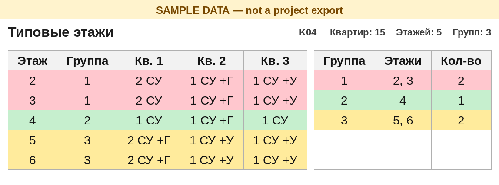

# Кейс 07 — Типовые этажи из связи АР

[← К хабу](../../README.ru.md) · [EN](README.md)

## Проблема

На жилом объекте из нескольких корпусов инженеру ОВ нужен список типовых этажей: этажи, у которых в каждой квартире один и тот же набор помещений — совмещённый санузел (СУ), уборная, гардеробная. Результат — его «Таблица 1»: Этаж | Номер | Тип | Комнат | Sобщ | Sж | СУ | Уборная | Гардеробная.

Revit отдаёт только сырые строки помещений. Все суммы, номера групп и сама таблица считаются в Excel: формулу видно и можно поправить. Задача повторяется на каждом объекте, архитектурные команды и имена параметров разные, поэтому имена должны быть настройкой, а не зашитым поиском.

## Решение

Граф Dynamo (Revit 2024, CPython3) читает помещения из **загруженной связи АР**, не из модели ОВ, и пишет сырые строки на лист «Выгрузка» через `Data.ExportExcel`. Одна строка — одно помещение. В Revit ничего не суммируется.

- Если загружена ровно одна связь АР, она выбирается сама. Необязательный фрагмент имени сужает выбор, когда связей несколько. Сравнение не смотрит на регистр, на `_` / пробел / `-` / `.` и на похожие буквы кириллицы и латиницы.
- Код корпуса (`K` и две цифры) берётся из имени связи. Отчёт — `Типовые_этажи_<код>.xlsx` в папке отчётов. Если файла нет, он копируется из `Типовые_этажи_ШАБЛОН.xlsx`. Отчёт одного корпуса не затирает другой, и папку не нужно готовить заранее под каждый корпус. Ненайденная связь пишется в `Типовые_этажи_ОШИБКА.xlsx`. Нет папки, нет шаблона или файл открыт в Excel — отдельные понятные ошибки.
- Повторная выгрузка заменяет только «Выгрузку». Настройки и расчётные листы остаются и пересчитываются.
- Шаблон — только формулы (Excel 2010+, без макросов): «Настройки» (номера столбцов, варианты имён помещений, учитывать ли тип квартиры), скрытые листы расчёта, «Типовые этажи» (подпись этажа → номер группы, цвет группы), «Таблица 1». Ссылки на «Выгрузку» идут через `INDIRECT`: ExportExcel удаляет лист и создаёт его заново, обычная ссылка стала бы `#REF!`.

Строки `KLWT_*` в узле Python — **примеры имён параметров** (общие параметры одного заказчика). На следующей АР меняют блок НАСТРОЙКИ. Варианты имён для трёх столбцов правят на листе «Настройки», формулы не трогая.

Пределы шаблона: 15 квартир на этаже, 80 этажей, 1500 квартир, 3000 строк выгрузки.

## Скриншот

Лист «Типовые этажи» после пересчёта LibreOffice на **учебных строках** (это не выгрузка объекта). Пустые столбцы квартир убраны, чтобы три выдуманные квартиры и список групп стояли рядом. Цвет группы — то, ради чего лист. Проверенный результат по корпусу — в таблице ниже, не на картинке.

## Масштаб / контекст проекта

| | |
|--|--|
| Статус | Проверено в Excel на одном реальном корпусе |
| Эффект | 166 квартир, 16 этажей (2–17), сведены в 10 групп: 2 \| 3 \| 4 \| 5 \| 6 \| 7–12 \| 13–14 \| 15 \| 16 \| 17 |
| Пишет в модель? | **Нет** — читает связь АР, пишет только `.xlsx` |
| Повторяется? | На каждом объекте; имена параметров и вариантов помещений — настройки |

## Безопасность

- Граф не сохраняет, не синхронизирует и не освобождает открытую модель ОВ. Он читает помещения документа связи.
- Правила audit/apply для пакетной записи в модели здесь не задействованы: записи в модель нет. Остальное портфолио — [docs/SAFETY.ru.md](../../docs/SAFETY.ru.md).
- Не указывайте папкой отчётов боевое хранилище и путь, который не проверяли. В опубликованном графе поле папки пустое.
- Сбой связи уходит в отдельный `…_ОШИБКА.xlsx`, а не в отчёт корпуса.

## На что наступили

- **Редактор** Dynamo не выполняет узел Python повторно, если код узла не менялся. Запускайте из **Проигрывателя** (или измените вход), иначе выгрузка не обновится.
- `Data.ExportExcel` с перезаписью пересоздаёт «Выгрузку», и прямые ссылки становятся `#REF!`. В шаблоне стоит `INDIRECT`.
- Окно выбора папки не принимает UNC с клавиатуры. Закрепите шару в «Быстром доступе» или замените узел Directory на String с путём (заглушка: `\\server\share\Project\Scripts\TypicalFloors`).
- Короткий фрагмент имени путал корпуса (`…_01_…` и `…_02_…`), когда буквы выглядели одинаково. Теперь единственная загруженная связь АР выбирается сама, а вписанный фрагмент сравнивается без регистра, разделителей и пар кириллица/латиница.

## Запуск

1. Скопируйте `src/` в папку, которую видят и Excel, и Revit 2024. `Типовые_этажи.dyn` и `Типовые_этажи_ШАБЛОН.xlsx` лежат рядом.
2. Один раз на ПК: Проигрыватель Dynamo → укажите эту папку и вход «Папка отчётов». «Связь АР» оставьте пустым, если в модели одна связь АР.
3. Откройте модель ОВ (связь АР загружена) → Проигрыватель → Запуск.
4. Откройте `Типовые_этажи_Kxx.xlsx`. Если Excel не пересчитал — F9.

По шагам, включая обход UNC через узел String и блок настроек: [src/INSTRUCTION.ru.md](src/INSTRUCTION.ru.md) · [src/INSTRUCTION.md](src/INSTRUCTION.md).

Собрать шаблон заново (только шапка, без строк объекта): из `src/` выполнить `python build.py empty Типовые_этажи_ШАБЛОН.xlsx`.

Код и граф: [`src/`](src/)
